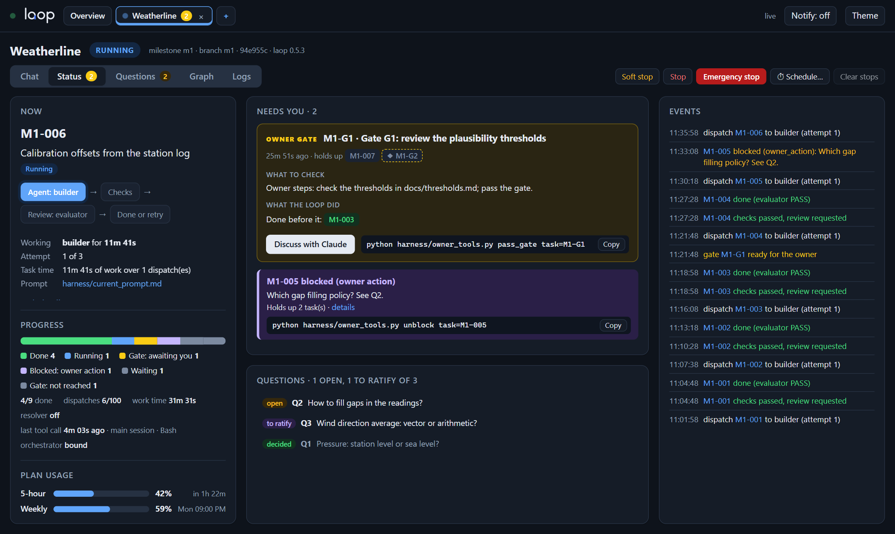
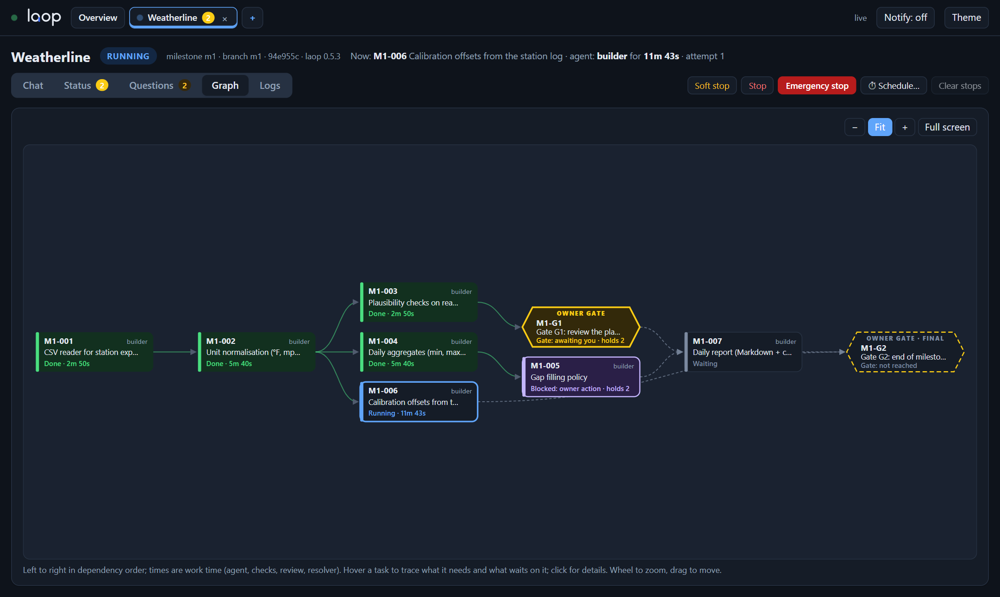
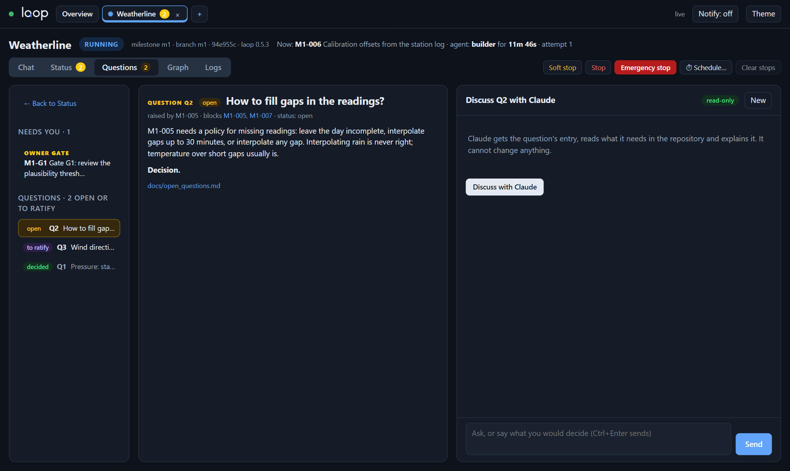
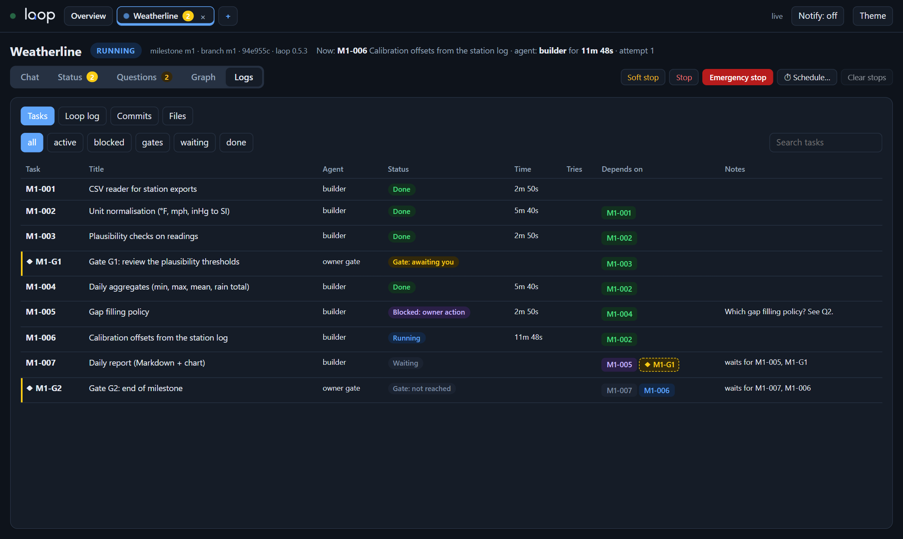

<p align="center"></p>

# laop

**A task loop for Claude Code that keeps building while you decide only what matters.**

laop turns a Claude Code session into a thin *orchestrator* that works through a milestone task by
task: a fresh builder subagent writes each task, the step scripts run its checks, a reviewer
subagent judges it, and the loop moves on. A guard hook enforces what every role may read, write
and run. You define what to build, answer the questions that are really yours and pass the
gates; everything else runs without you.



## Why

Long autonomous coding runs tend to fail in the same ways: an agent edits the tests it should pass,
"fixes" a spec it does not like, sweeps the owner's edits into its commits, makes a design decision
nobody asked for, or keeps going after something broke. laop moves every decision that can be
taken in code (which task, pass or fail, retry, block, halt) **out of the model and into scripts**,
and puts a hook in front of every tool call:

- **Code decides, the model executes.** The orchestrator only runs `step_next.py`,
  `step_verify.py`, `step_record.py` and `step_resolve.py`, and spawns exactly the subagent they ask
  for, with their prompt.
- **Roles with hard limits.** The builder writes only its allowlist; reviewers cannot touch the
  code; independent checkers cannot even read the reference data; loop roles may commit but never
  reset, rebase, push or merge.
- **Every task is checked twice.** Acceptance checks and global checks in code, then an independent
  reviewer in a fresh context. A failure goes back to the builder with the findings.
- **You stay in charge of decisions.** Questions go to the owner; a resolver/challenger pair can
  answer the ones you have delegated, provisionally, until you ratify them. Gates stop the loop
  where you want to look.
- **Stop at any time.** Three stop files, from "finish what you are doing" to "block every tool
  call now".

## How it works

```
 owner ──► /laop discover (once) ──► docs/spec.md, docs/plan/roadmap.md ──► owner approves
 owner ──► /laop brief <m> (each milestone) ──► docs/plan/<m>.brief.md ──► owner approves
 owner ──► planner subagent ──► harness/tasks.json ──► owner approves
                                                         │
 /laop-start (this session becomes the orchestrator) ◄───┘
    │
    ├─ step_next.py      picks the next ready task (gates wait for the owner), writes its prompt
    ├─ Agent(builder)    fresh context; ends with a commit and harness/claim.json
    ├─ step_verify.py    integrity, protected paths, the claim, acceptance and global checks
    │    ├─ REVIEW  ─► Agent(reviewer) ─► step_record.py      PASS → done, NEEDS_WORK → retry
    │    └─ RESOLVE ─► Agent(resolver) ─► Agent(challenger) ─► step_resolve.py
    │                     answer + agree → provisional decision, the task resumes; else → owner
    └─ repeat; a Stop hook keeps the orchestrator going while the loop is active
```

| Role | What it does |
|---|---|
| **owner** (you) | Writes or approves the spec, roadmap and briefs; passes gates; decides questions. Any session you type in is yours. |
| **orchestrator** | The session that ran `/laop-start`. Runs only the step scripts and spawns the subagent they expect. |
| **analyst** | Turns an idea into a spec (stories, EARS requirements, success criteria) and a roadmap, then a brief per milestone. |
| **planner** | Splits a milestone into `harness/tasks.json`: tasks, dependencies, acceptance checks, gates. |
| **builder** | Implements one task, commits, and writes a claim (done, or blocked with a question). |
| **evaluator** | Reviews one task in a fresh context: PASS or NEEDS_WORK with findings. |
| **resolver / challenger** | Answer an open question with the owner's principles, then attack that answer. |
| project roles | Add your own in `harness/roles.json`: a UI reviewer, a blind independent checker, a runner of an external program… |

The full manual, installed in every repository, is
[`skill/core/harness/README.md`](skill/core/harness/README.md).

## laop monitor

One page (or desktop window) for every repository that runs the loop. It reads the harness files
and changes nothing on its own: you see what runs, what waits for you and why, with the exact
command to copy, and you can discuss any decision with Claude before applying it.

**Graph:** the milestone's dependency graph, with what is done, running, blocked and waiting for a
gate.



**Questions:** every open, provisional and decided question of the project. "Discuss with Claude"
opens a read-only discussion that ends with a decision you can apply in one click.



**Logs:** tasks with status, time and dependencies, plus the loop log, the commits and the files.



Also: a **Chat** view (Claude Code in the repository, with a *Start loop* button), soft/hard/
emergency stop buttons per repository or for all of them, scheduled stops, your plan usage, and
browser or Windows notifications. See [`viewer/README.md`](viewer/README.md).

## Requirements

- [Claude Code](https://claude.com/claude-code) (CLI or desktop app).
- Python 3.11+. The harness and the monitor use the standard library only.
- Git. The loop works on a milestone branch and refuses to run on protected branches.
- Optional: `pywebview` for the monitor's desktop window; `pyinstaller` and `pillow` to build it as
  a single `.exe`; an [ntfy](https://ntfy.sh) topic for phone notifications.

Tested mostly on Windows; the hooks also run on macOS and Linux.

## Install

Clone this repository and link (or copy) `skill/` into your Claude Code skills directory as
`laop`:

```
# Windows (junction)
mklink /J "%USERPROFILE%\.claude\skills\laop" "<path to this repo>\skill"
# macOS / Linux
ln -s "<path to this repo>/skill" ~/.claude/skills/laop
```

## Quick start

In the repository you want to build, in Claude Code:

1. **`/laop init`.** A short interview (purpose, your principles, stack, checks, what the builder
   may write), then the harness is installed and checked with `laop doctor`. Restart the session and
   look for `<name> guard active (laop <version>)`.
2. **`/laop discover`.** From an idea or an existing document to `docs/spec.md` and
   `docs/plan/roadmap.md`. Approve them with `python harness/owner_tools.py approve doc=spec` (and
   `doc=roadmap`).
3. **`/laop brief m1`.** What the first milestone means, in and out of scope, the decisions it needs
   from you. Approve it, then create the branch: `git switch -c m1`.
4. **Plan.** Ask the `planner` subagent for `harness/tasks.json` and review it.
5. **`/laop-start`.** The session becomes the orchestrator and the loop runs until it finishes,
   reaches a gate with nothing else to do, or you stop it.
6. **Follow it** with the monitor: `python viewer/viewer.py` (it opens
   `http://127.0.0.1:8765`; add the repository with the "+" tab).

Other modes: `/laop upgrade` (new harness version), `/laop add-role`, `/laop doctor` (is the guard
active?), backtest (measure the resolver on questions you have already decided).

## Owner controls

| Control | Effect |
|---|---|
| `AGENT_SOFT_STOP` at the repository root | The agent at work finishes; the loop stops before the next one. |
| `AGENT_STOP` | The builder commits its work in progress with a handoff note and ends. |
| `AGENT_EMERGENCY_STOP` | Every tool call of every session is blocked at once. |
| `harness/STEER.md` | A note added to the next dispatched prompt. |
| `python harness/owner_tools.py` | `status`, `pass_gate`, `decide`, `ratify`, `override`, `unblock`, `resume`, `reverify`, `release`… |

You can keep working in a second session while the loop runs: the guard records the files you
write, and the step scripts leave them out of the task's checks and commits.

## Repository layout

| Folder | What |
|---|---|
| [`skill/`](skill/) | The `/laop` Claude Code skill: the harness (`core/`), its installer (`tools/laop.py`: `init`, `adopt`, `upgrade`, `doctor`, `render`), templates, tests. Start from [`skill/SKILL.md`](skill/SKILL.md). |
| [`viewer/`](viewer/) | laop monitor. See [`viewer/README.md`](viewer/README.md). |
| [`assets/`](assets/) | Logo. |
| [`docs/screenshots/`](docs/screenshots/) | The images of this page (a demo project). |

## Tests

```
python -m unittest discover -s skill/tests
python -m unittest discover -s viewer/tests
```

## Status

Experimental and changing quickly: the harness format and the installer's commands may change
between minor versions (see [`skill/CHANGELOG.md`](skill/CHANGELOG.md)). Use `/laop upgrade` to
move an installed repository to a new version.

## License

[MIT](LICENSE) © 2026 Luca Amerio
